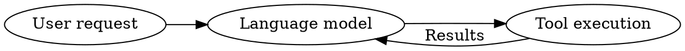

# Diagram rendering

The `render-diagram` tool renders Graphviz DOT source to PNG. It uses a
diagram renderer rather than an image-generation model, so labels and edges
come from the supplied source. The agent is still responsible for expressing
the user's intended diagram correctly.

## Setup

The plugin is listed in `config/plugins.yaml`. The Docker runtime installs
Graphviz. For a source installation, install Graphviz using your operating
system's package manager and ensure `dot -V` works. No extra Python package,
model API key, or rendering web service is required.

## Example

Pass complete DOT source as the tool's `dot_source` string:



The tool saves `diagram.png` and `diagram.dot` in a unique folder under
`<memoryDirectory>/diagrams/`. Successful calls return `DIAGRAM_RENDERED`
with both paths. Source is retained for edits and verification. These artifacts
remain until explicitly removed; repeated calls produce separate artifacts.

Invalid DOT, missing Graphviz, a rendering timeout, and filesystem failures
return `DIAGRAM_FAILED`. Failed renders remove their partial artifact folder.
Input is limited to 64,000 UTF-8 bytes, rendering to 15 seconds, and accepted
PNG output to 10 MB. The output-size check happens after rendering; it is not
a process memory limit. Graphviz runs without a shell and inherits Omega's
filesystem policy. DOT may reference external images, so the plugin must run
under the same access restrictions as the agent.

## Delivery and image generation

This checkout has no `generate-image` tool or photo-delivery interface.
Consequently this plugin reports **rendered**, never **sent**. It does not
import a Telegram implementation from another repository or invent a delivery
success. A photo-capable channel integration remains required to complete
automatic photo delivery.

The core tool guidance directs diagram requests to `render-diagram`. When
a generative-image tool is added, its description should reserve it for
illustrations and photographs and direct diagrams to this renderer.

Only Graphviz DOT is supported in this initial plugin; Mermaid is not accepted.

## Tests

From the repository root:

```sh
python -m unittest discover -s tests -p test_render_diagram.py -v
```

The real-renderer tests run when `dot` is on PATH; otherwise they are explicitly
skipped. Other tests use a simulated renderer and never call model services.
