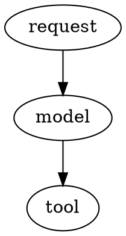

# Diagram rendering

`render-diagram` renders Graphviz DOT source to PNG with exact supplied labels
and edges. It accepts a single `dot_source` argument, not Markdown or prose.
It does not upload images or send photos. Mermaid is not supported.



## Setup and resource limits

The plugin is registered in `config/plugins.yaml`. Docker supplies Graphviz and
util-linux `prlimit`. Source installations require Linux with `dot` and `prlimit`
on PATH. If either is unavailable, rendering fails without starting Graphviz.

The renderer has OS-enforced limits of 512 MiB address space, 10 CPU seconds,
10 MB per output file, 64 open descriptors, and zero core-dump size. A 15-second
wall-clock timeout provides an additional limit. Stderr is discarded rather
than captured in an unbounded buffer. Input is limited to 64,000 UTF-8 bytes;
malformed Unicode returns `DIAGRAM_FAILED`. Only one render runs per agent at
a time. PNG dimensions are checked after rendering; the resource limits apply
before layout starts, including for oversized canvases.

Graphviz inherits Omega's Landlock policy. These resource limits do not replace
filesystem isolation; run the agent with its normal filesystem policy.

## Artifact lifecycle

Every render uses a private staging folder under `<memoryDirectory>/diagrams`.
By default, both DOT and PNG are deleted after processing, including on failure.
Success returns `DIAGRAM_RENDERED` with an explicit statement that artifacts
were removed, rather than a path to a deleted file.

To obtain local PNG and DOT paths, explicitly set `retainDiagramArtifacts: true`
in configuration (or `OMEGA_retainDiagramArtifacts=true`). This is a host setting,
not an argument that the model can enable. Successful results then include
`file=` and `source=` paths; they do not claim delivery.

Retention keeps at most 20 diagram directories. Directories older than 24 hours
are pruned on the next render; no background expiration timer runs. Disabling
retention removes prior plugin artifacts on the next render. Failed staging
files are always removed. Staging left by an abrupt process termination is
also covered by the next pruning pass. Pruning ignores symlinks and only touches
`diagram-*` directories under the plugin's own root. Cleanup permission errors
return `DIAGRAM_FAILED` rather than claiming successful cleanup.

The checkout has no `generate-image` tool to reword. Existing core guidance
continues to direct diagram requests to this renderer. Photo delivery is outside
this change's scope.

## Tests

```sh
python -m pytest tests/test_render_diagram.py
PETTA_PATH=/PeTTa sh tests/mettatest.sh
```

Real Graphviz tests require Linux `dot` and `prlimit`; other tests use a simulated
renderer. The MeTTa test exercises plugin registration and valid/invalid DOT.
